# 把首页换成两幅水墨画：一次前端改造的技术记录，以及我和 AI 协作的方式

> 这篇是我把博客首页整个重做一遍的过程记录。前半部分是技术：一个"状态只有一个来源"的前端架构、滚轮切屏、按字裁剪的中文书法体、纯 CSS 动态、位图修补、遮罩转场，以及怎么把性能数字测准。后半部分是方法：这一轮我几乎全程和 AI 结对，哪些做法真的省事、哪些坑是它自己挖的。

---

## 0. 先说结论

| 需求 | 做法 | 结果 |
| --- | --- | --- |
| 首页要变成"国风山水"：正常态雪山梅花，悬停变江湖武侠 | 两张生成的水墨图 + 纯 CSS 层叠与状态属性 | 一个 HTML 属性切换整套视觉，不需要重新请求任何资源 |
| 鼠标滚轮在顶部要能直接切到下一屏，且和"向下按钮"完全一致 | 边界容差 + 守卫锁 + `scrollend` 解锁 | 落点精确到像素（1200×800 下 801px），按钮与滚轮完全同一条路径 |
| 首屏不能因为改造变慢 | 字体按字子集、去掉无用字体、预载清零、CLS 归因 | CLS 0.165 → **0**；冷缓存弱网 LCP 3872 → **3156ms**；4× CPU 下稳定 60fps（p95 16.8ms） |
| 以后要加"雪落 / 云雾 / 视差 / 墨晕"等地动态 | 预留 `.hero-fx` 层 + 只动 `transform/opacity` 的约束 | 雪落、风痕、归鸟、灯火、墨晕转场都已上线，仍保持 60fps |

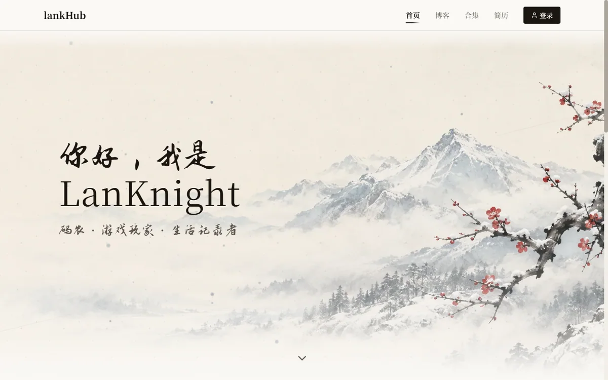
*正常态：雪山、梅枝、行书题字。注意标题的中文是手写体，而 Latin 部分是衬线体 —— 这是故意分开的。*

---

## 1. 这次要解决什么

起点是个很小的抱怨：首页那个"向下箭头"虽然能点，但鼠标正常往下滚，页面也会**越过首屏**（浏览器原生行为）。于是那个按钮看起来就像个摆设。

改着改着范围变成了"整个首屏重做"，于是有了四条硬约束：

| 约束 | 它逼出来的设计 |
| --- | --- |
| 视觉要两套（雪山 / 江湖），且要能随时加动态 | 视觉不能写在 React 里，必须收敛到一个"状态 + CSS"的模型 |
| 首屏是 LCP 元素，不能被改造拖慢 | 不引入任何动画库；动态全部走合成器；字体按需子集 |
| 素材只有两张**扁平位图**（没有分层 PSD） | 不能做真景深、不能让梅枝摇；只能靠"叠加层"和"遮罩"制造纵深 |
| 以后要能加雪、雾、视差、墨晕 | 层结构必须预留，且每层职责单一 |

第三点是全程最需要克制的：**扁平图能做的事有上限**。所以从第一天就把"做不到的部分"写进文档，而不是先承诺再解释。

---

## 2. 架构：一份真相，全 CSS 响应

整页的视觉差异只有一处源头：

```html
<html data-hero-scene="snow | jianghu">
```

React 只负责"什么时候改这个属性"，所有像素差异都由 CSS 派生：底图显隐、夜色叠加、文字颜色、导航栏反色、印章落印、动态层启停。

```css
/* 场景层：两态都渲染、叠着放，靠 opacity 交叉淡入 */
.hero-scene { position: absolute; inset: 0; opacity: 0; transition: opacity 420ms ease; }
.hero-scene[data-scene="snow"]   { opacity: 1; }
:root[data-hero-scene="jianghu"] .hero-scene[data-scene="snow"]   { opacity: 0; }
:root[data-hero-scene="jianghu"] .hero-scene[data-scene="jianghu"] { opacity: 1; }
```

为什么不"换个 ``"就完事：换 src 会有一帧空白（新图还没解码完），而两态都放在 DOM 里、叠着交叉淡入，天然平滑；两张图合计 184KB，也付得起。

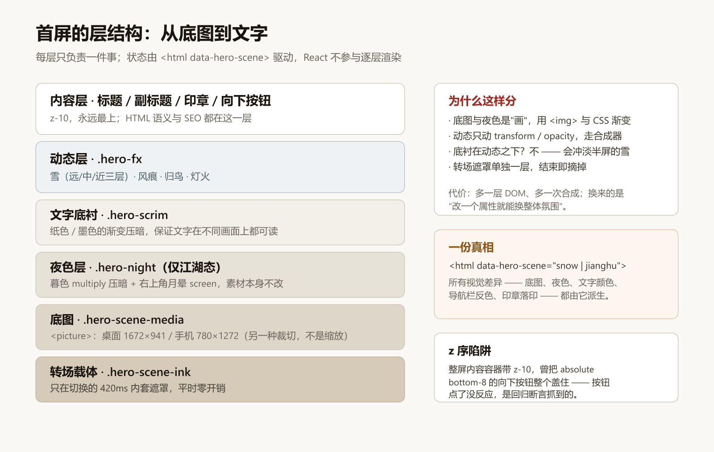
*每层只做一件事：底图 → 夜色 → 文字底衬 → 动态 → 文字。*

两个和这张图有关的实战细节：

- **动态层必须画在"文字底衬"之上**。我第一版把它放在底衬下面，结果雪落到画面下半部就被那层纸色渐变压没了 —— 截图里只有上半屏有雪。
- **整屏内容容器带 `z-10`，曾把 `absolute bottom-8` 的向下按钮整个盖住**，按钮点了没反应。这个不是靠肉眼发现的，是回归断言里的"按钮命中测试"抓到的。

---

## 3. 滚轮切屏：别跟浏览器抢控制权

需求听起来简单："滚轮下滚就切到下一屏"。难的地方在于**什么时候把控制权还回去**。

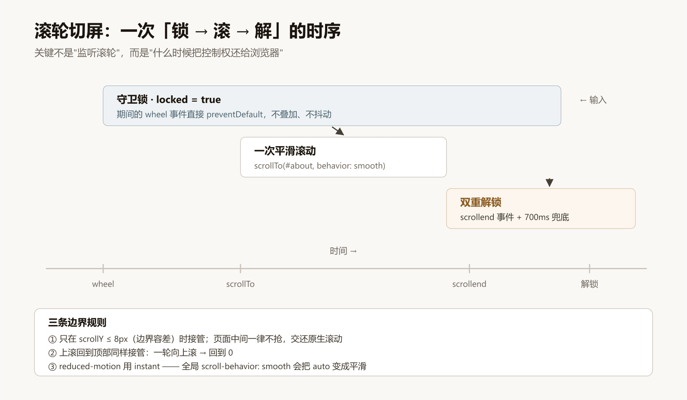

实现要点（`use-hero-paging.ts`）：

1. **只在边界接管**：`scrollY <= 8px` 时才响应下滚，页面中间一律不抢 —— 否则用户滚不动文章列表会是灾难。
2. **守卫锁**：接管瞬间上锁，锁期间所有 `wheel` 直接 `preventDefault`，避免惯性连击叠加成"跳两屏"。
3. **解锁用 `scrollend` 事件，加 700ms 兜底**：这是唯一可靠的"滚动真的停了"的信号。
4. **`prefers-reduced-motion` 下用 `behavior: "instant"`，不能写 `"auto"`** —— 全局 CSS 里有 `scroll-behavior: smooth`，`auto` 会被它变成平滑滚动。

这里踩过一个测量坑：我最初判断"滚动结束"的办法是"连续两帧 `scrollY` 相同"。这个办法在 `smooth` 滚动的缓出阶段会误判，导致断言假失败。换成监听 `scrollend` 并累加计数才稳定。

最终落点：1200×800 下 `#about` 顶部是 **801px**，点按钮与滚轮两路完全一致。

---

## 4. 两套场景：状态机与两个热区

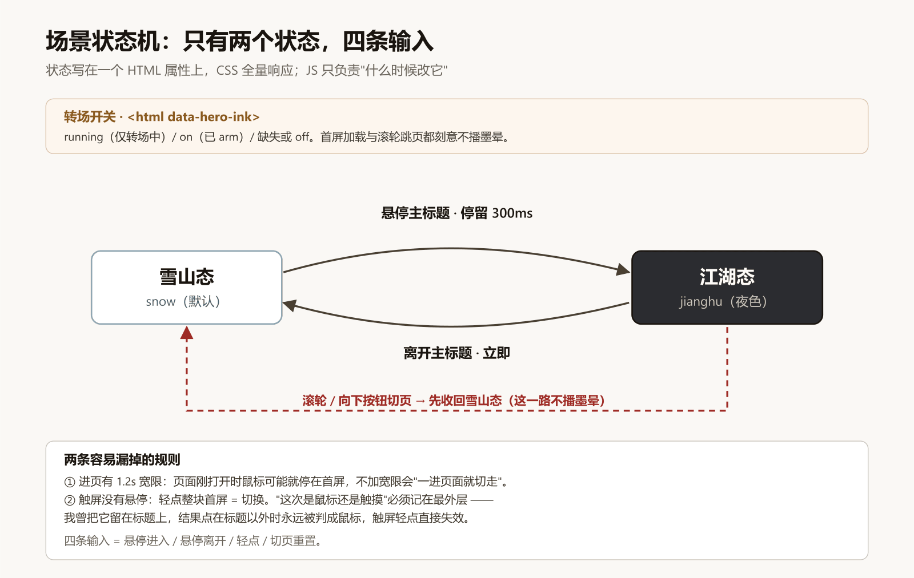

四条输入，两个参数：

- **进页宽限 1.2s**：页面刚打开时鼠标很可能就停在首屏正中，不加宽限就会"一进页面就切走"，用户根本看不到雪山。
- **停留 300ms 才切**：鼠标只是扫过标题不该触发；离开立刻回到雪山。

这一节最大的坑是我自己挖的，还挖了两次：

1. **悬停热区**：我第一版做成了"整屏悬停"，用户验收时直接指出"原方案是悬停在主标题上才切"。改回标题区之后……
2. **触屏直接失效**：因为"这次是鼠标还是触摸"的记录还留在标题的 `pointerenter` 里。点在标题以外时，那个记录永远不会被更新，于是永远被判成鼠标，轻点切换失效。

> **教训：热区可以收窄，但"判断输入类型"的钩子必须挂在最外层。**

---

## 5. 字体：按字子集，换来一个"手写感"

首屏那行中文要手写体，但不能为几个字加载整套中文字体（一套 3–8MB）。做了个对比之后选了第三条路：

| 方案 | 观感 | 体积 | 风险 |
| --- | --- | --- | --- |
| 系统宋体兜底 | 干净但普通，和"手写题字"差很远 | 0 | 无 |
| 引入 Noto Serif SC 900 | 粗宋，不像毛笔 | 中文分片合计可达 1.4MB | 拖慢首访 |
| **志莽行书，按字裁剪子集** | 接近手写 | **13KB** | 改文案必须重做子集 |

做法：只保留首页真正用到的约 40 个字，`unicode-range` 限定在 CJK 区间，Latin 自动回落到站点的衬线字体。所以标题"你好，我是 LanKnight"里，中文是行书、英文是衬线 —— 这不是 bug，是设计。

另外做了"逐字错落"：把中文逐字包成 `<span>`，用一张**固定的**节奏表给每个字不同的字号（0.90–1.09em）和基线偏移（−0.02~0.03em）。

为什么不用随机：随机值每次渲染都可能不同，服务端与客户端不一致会触发水合告警；而且"随机"在视觉上更像抖动，不像书写节奏。

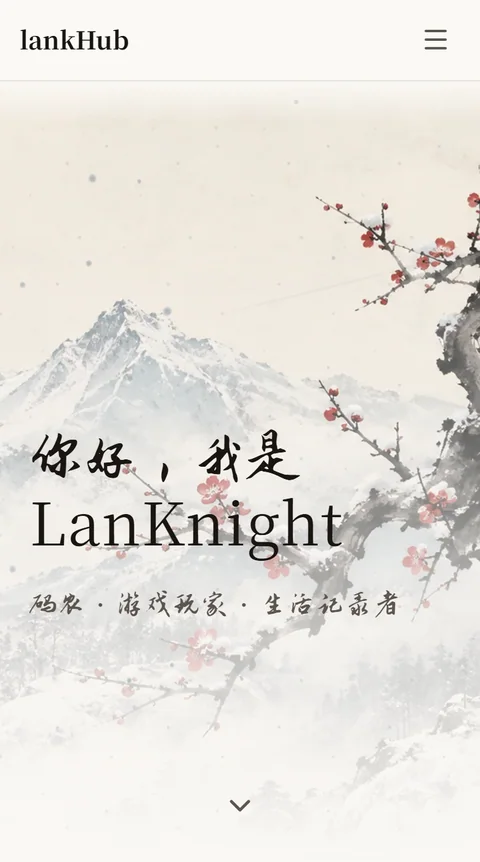
*手机端不是把 16:9 缩放，而是另出了一张竖版（780×1272）—— 否则梅枝和人物会被裁掉。*

---

## 6. 动态：只用 transform/opacity，但坑在别处

雪、风痕、归鸟、灯火，全部是纯 CSS 动画，没有动画库，没有 Canvas。

| 元素 | 实现 | 关键参数 |
| --- | --- | --- |
| 雪·远层 | 平铺纹理（零 DOM） | 瓦片 90×180，位移正好一格 → 无缝斜落 |
| 雪·中景 | 24 个 `<span>` | 2.5–5px，11–20s，横向漂移 300–420px（约 23°） |
| 雪·近景 | 12 个 `<span>`，带模糊 | 5–9px，8–15s，负责景深 |
| 风痕 | 6 条斜向渐变线 | 1.6px，0.3–0.45 透明度 |
| 归鸟 | 5 只描边剪影 + 拍翅 | 28×10px，18–26s 穿屏，拍翅 0.42s |
| 灯火 | 一团 `screen` 混合暖光 | 3s 不规则忽明忽暗 |

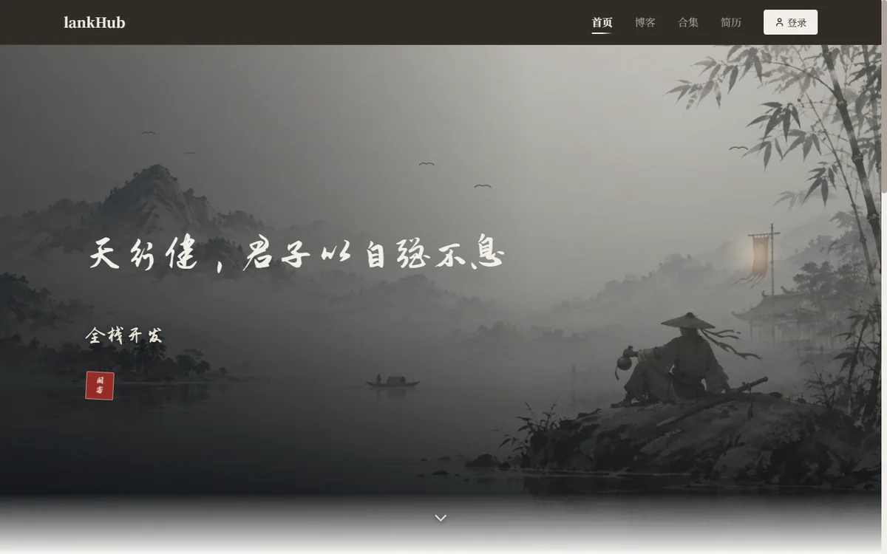
*悬停标题后的江湖态：夜色、月晕、归鸟、酒旗旁的一点灯火。*

三个坑，一个比一个隐蔽：

1. **`translate: 114%` 的百分比是相对元素自身算的。** 一只 17px 宽的鸟，写百分比等于一辈子只飞 19px。我一度以为"鸟不明显"是速度太慢，其实是**它几乎没动**。跨屏位移必须用 `vw/vh`。
2. **白点在米白纸上看不见。** 第一版雪是纯白，观感约等于没有。正确的解法是**改颜色**（冷灰），而不是加数量 —— 这条是用户直接点出来的，我当时正准备把数量翻倍。
3. **两层雪+风痕放到"文字底衬"下面，会被纸色渐变冲淡**（见第 2 节）。

怎么证明"它真的在动"：静帧看不出，所以做了两件事 —— 取两个时刻的**像素差异百分比**（雪山区域 3.06%、灯火区 9.47%），以及直接量元素位移（雪 1.2s 内 −24px/+56px，鸟 −88px）。

---

## 7. 擦掉原图里的鸟：一次位图修补

江湖那张参考图本身画了一群鸟。我又加了一群"动态鸟"，两批鸟并存显得很突兀 —— 用户要求把原图的静态鸟去掉。

扁平位图没有图层，所以只能"修补"：

1. **自动检出**：天空区域转灰度、阈值 178、8 邻域连通域，只认"面积 ≥6、宽 ≥5、宽高比 ≥1.05、且完全在天空带内"的块（1–4px 是纸纹噪点，再往下是雾山树冠）。
2. **克隆修补**：每只鸟从附近一块**干净的雾天空**克隆过来，而不是就地模糊 —— 就地模糊会把纸纹一起抹平，留下比周围更"平"的矩形淡痕。
3. **羽化**：补丁边缘用 alpha 斜坡渐隐，避免硬边。

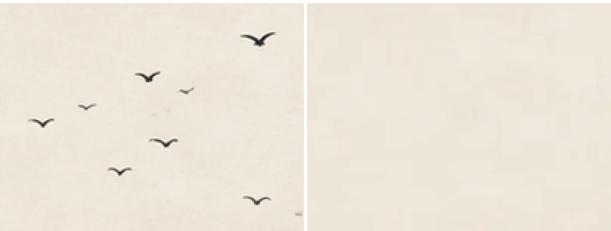
*4× 放大：左=原图，右=擦除后。剩下的是极淡的痕，1× 下看不出来。*

两次白跑值得一提：

- 用 SVG 的 `feGaussianBlur` 做羽化，在小矩形上会被滤镜区域裁掉，蒙版几乎全透明 —— 补丁等于没贴，鸟原地不动。改成**直接生成 alpha 缓冲**才生效。
- 阈值 150 漏掉了最右边那只浅灰的鸟；提高到 178 后噪点变多，靠上面的形态规则挡住。

---

## 8. 墨晕转场：mask + `@property`

两态切换原来是 420ms 交叉淡入。想要的观感是"新画面像墨一样从鼠标位置洇开"。

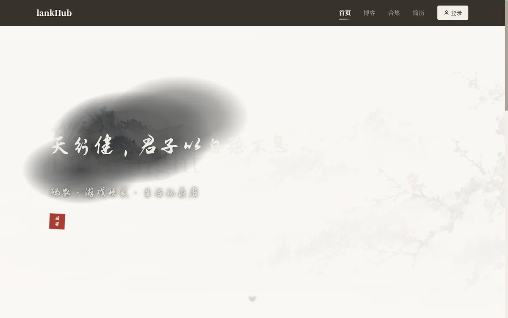
*转场开始约 60ms：墨团刚在标题处出现（半径 15.7%）。*

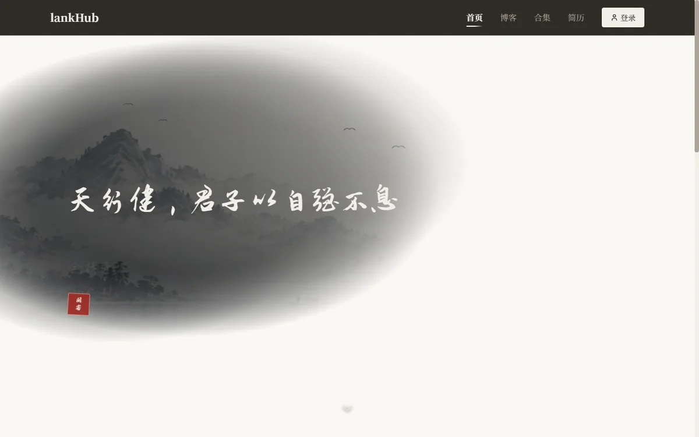
*约 140ms：墨团铺开（半径 36.7%），边缘是三个偏心椭圆取并集后的不规则边。*

核心只有三行是新的：

```css
@property --ink-r { syntax: "<percentage>"; inherits: false; initial-value: 0%; }

.hero-scene-ink {
  mask-image: radial-gradient(ellipse var(--ink-r) var(--ink-r) at var(--ink-x) var(--ink-y),
              #000 0%, #000 56%, rgba(0,0,0,.55) 80%, transparent 100%);
  animation: hero-ink-spread 420ms linear both;
}
@keyframes hero-ink-spread { from { --ink-r: 0% } to { --ink-r: 110% } }
```

三个坑：

1. **`radial-gradient(circle 30%, …)` 是非法值。** circle 的半径只接受长度，百分比只允许用在 `ellipse` 上；写错的话整条 `mask-image` 被丢弃，效果**静默消失**。
2. **`mask-image` 不能写进 `@keyframes`。** 它不可插值，Chrome 会整条忽略 —— 我第一版就这么写的，转场时 `mask-image` 一直是 `none`。正解是遮罩写在基础规则里，只让注册过的 `--ink-r` 插值。
3. **开关要三态**：`running`（仅转场中）/ `on`（已 arm）/ 缺失。首屏加载不播（否则首屏先被遮罩成空白），滚轮跳页不播（页面正在被滚走）。收回开关用 `animationend`，不要用定时器。

---

## 9. 性能：数字、口径与方法

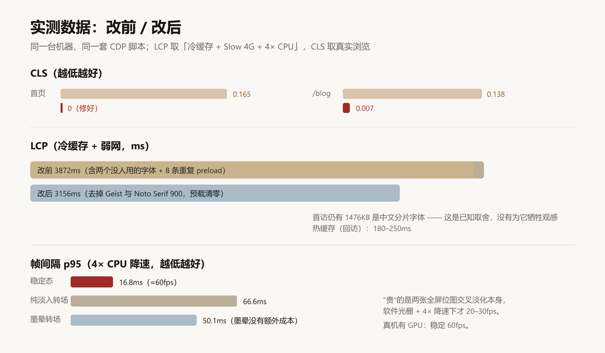

| 指标 | 改前 | 改后 | 测法 |
| --- | --- | --- | --- |
| 首页 CLS | 0.165 | **0** | 真实浏览 + `PerformanceObserver` 归因 |
| `/blog` CLS | 0.138 | **0.007** | 同上 |
| LCP（冷缓存 + Slow 4G + 4× CPU） | 3872ms | **3156ms** | 关缓存重测 |
| LCP（热缓存，回访） | — | 180–250ms | CDP 采样 |
| 帧间隔 p95（稳定态，4× CPU） | — | **16.8ms** | rAF 采样 180 帧 |
| 转场期间 p95（4× CPU） | 66.6ms（纯淡入） | **50.1ms**（墨晕） | 同上，40 帧 |

两件方法论上的事：

**CLS 必须能归因。** 用 `PerformanceObserver` 观察 `layout-shift`，把 `entry.sources[].currentRect` 打出来：`某个容器 x 从 384 变成 380` —— 一眼就能看出是**滚动条出现导致可视宽度变化**。再用 CDP 分资源屏蔽做对照，能立刻排除"字体换字导致的跳变"这类误判。首页那 0.165 一开始就被我误判成字体问题，屏蔽字体后数字纹丝不动才排除掉。修法也只有两行：`scrollbar-gutter: stable` + 让加载骨架撑满一屏。

**LCP 的口径必须写清。** 我曾经报过"限速 LCP 432ms"，后来发现那是**热缓存**测的，真实首访是 3872ms。数字好看不是目的，口径诚实才是。

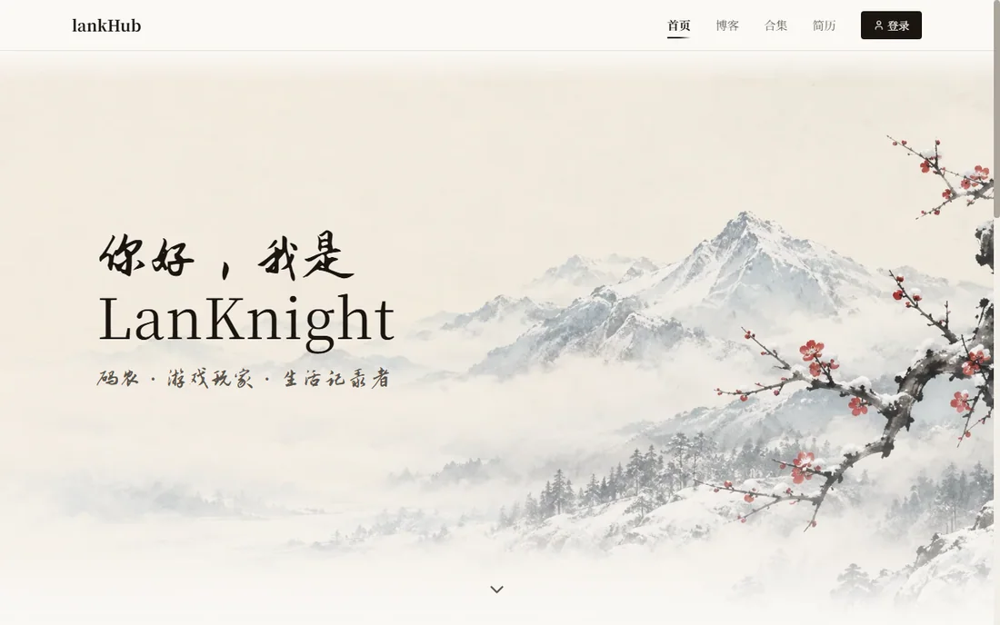
*系统开启"减少动画"后，动态层整体隐藏、转场直接瞬切 —— 停住的雪只是一张撒了白点的画。*

---

## 10. 和 AI 协作的十条

这一轮几乎全程 AI 结对（它写代码、跑浏览器验证、写文档）。真正有效的做法，和"提示词技巧"关系不大，更多是**流程**：

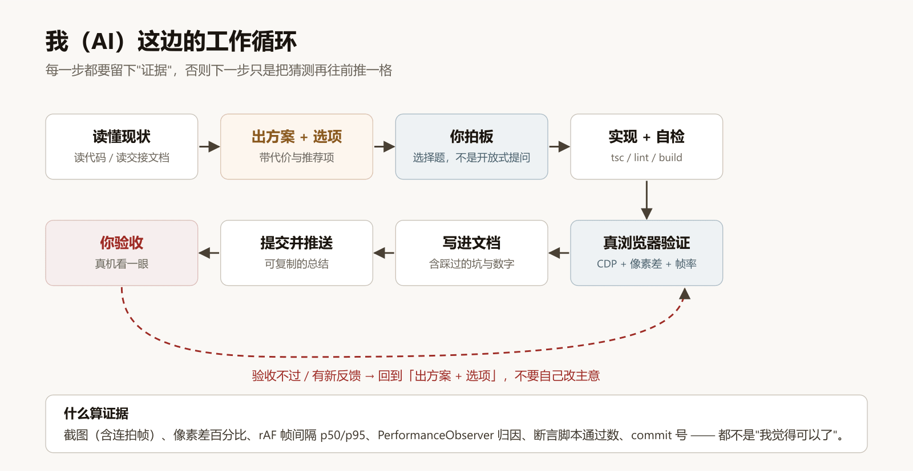

1. **让它先给方案和选项，别让它直接动手。** 选择题比开放提问高效得多：每个选项带"代价"，你只需要点一下。
2. **每个决定都要有代价说明。** 比如"加雾带"必须说清"要多一张 30–45KB 的派生图，且平铺接缝可能露馅"。
3. **要求"真实验证"，不接受"看起来对"。** 它会跑无头浏览器、截连拍帧、算像素差、采 rAF 帧间隔 —— 这些比"我觉得可以了"可靠得多。
4. **让它把结论写进文档，而不是留在对话里。** 下一个会话它读交接文档就能接上，你不用重讲一遍背景。
5. **明确"不要扩大范围"。** 它会顺手重构相邻代码，这通常是好习惯，但在收尾阶段是风险。
6. **每次改完立刻提交，并给一份可以直接复制的总结。** 出问题能精确定位到某一次改动。
7. **不许它用"我觉得"。** 要么给数字，要么给截图，要么给断言通过数。
8. **报错要根因，不接受"已修复"。** 我这一轮纠正过它两次"其实没生效"（`mask-image` 一直是 `none`）。
9. **验收必须真机看一眼。** AI 只能看截图，看不到动效的"手感"；这一轮的四次返工（雪太淡、鸟太小、月晕看不见、热区错了）都是真人看出来的。
10. **它会自信地犯错，用脚本兜住。** 这一轮它至少三次"验证通过"是假通过 —— 因为断言写错了（比如把截图的开销算进了帧间隔）。所以断言本身也要被审视。

---

## 11. 这一轮 AI 犯过的错（它自己整理的）

| 现象 | 根因 | 教训 |
| --- | --- | --- |
| 鸟几乎不动 | `translate: 114%` 相对元素自身（17px） | 跨屏位移用 `vw/vh` |
| 雪看不见 | 白点在米白纸上 | 先改颜色，别加数量 |
| 半屏没有雪 | 动态层在文字底衬之下 | 层序要和"可读性"一起设计 |
| 墨晕完全没效果 | `radial-gradient(circle 30%)` 非法 | 静默失效最可怕，要探测 computed style |
| 墨晕仍然没效果 | `mask-image` 写进了 `@keyframes` | 不可插值的属性不能靠关键帧 |
| 转场"验证通过"但其实是假的 | 收回开关用了定时器，取帧时遮罩已摘掉 | 用 `animationend` 事件 |
| 帧率假警报 | 截图（PNG 编码）开销被算进采样 | 采样前静置 1.5s |
| 代码风格被整体重排 | 对 `src` 跑了默认配置的 prettier | 格式化前先确认项目风格 |

---

## 12. 如果你也要做，按这个顺序

1. 先把**状态**收成一个属性，把**视觉**赶进 CSS；不要用 React 状态驱动逐层渲染。
2. 滚轮/触摸接管之前，先定义**边界**与**归还条件**，否则一定会跟浏览器打架。
3. 任何"看不出来"的效果，先用**像素差 + 元素位移**证明它在动，再讨论好不好看。
4. 首屏做动态之前，先确认它不会拖慢 LCP：动态全部走 `transform/opacity`，离屏与 `reduced-motion` 必须能停。
5. 用扁平位图做"景深"要提前说明上限（不能摇树枝、不能衣袂飘）。
6. 验收清单里必须有**真人看一眼**这一项 —— 尤其是"明显不明显"这种判断。

---

### 附录

- 本文所有数字来自项目内 `docs/HISTORY.md` 与 `docs/HANDOVER.md` 的实测记录；原始数据见同目录 `metrics.csv`。
- 示意图源文件是同目录 `diagrams/*.svg`（可直接改字重画）。
- 截图是 headless Edge + CDP 抓的，不是设计稿。
