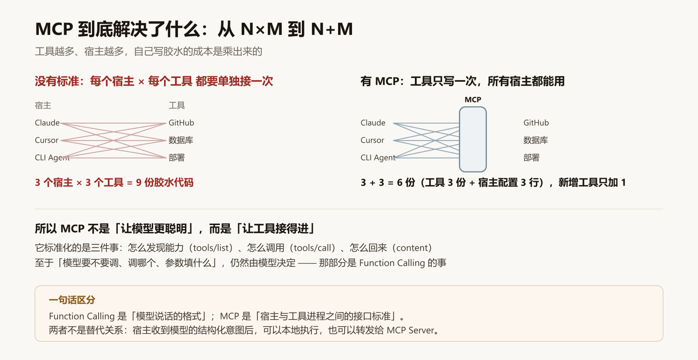
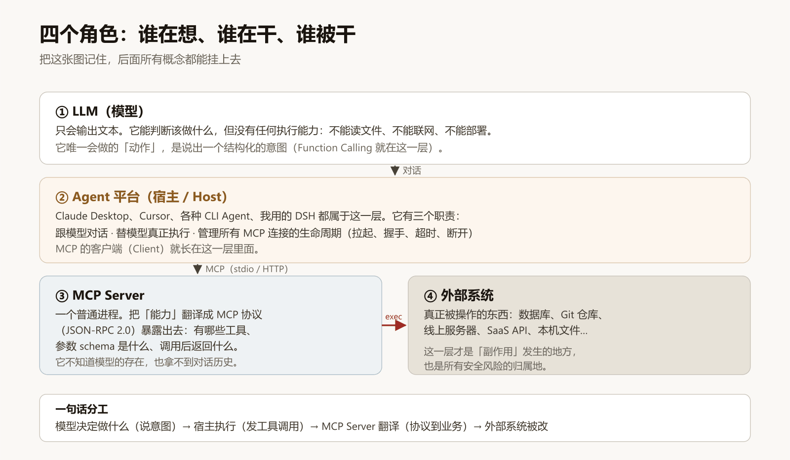
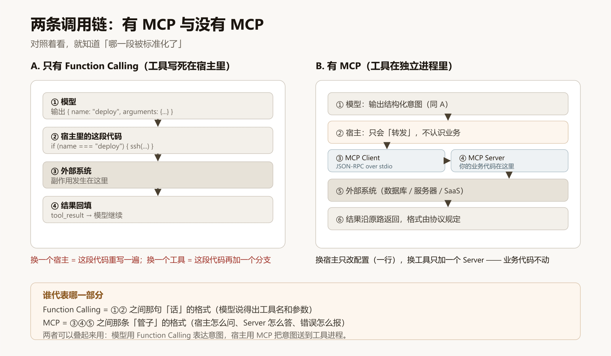
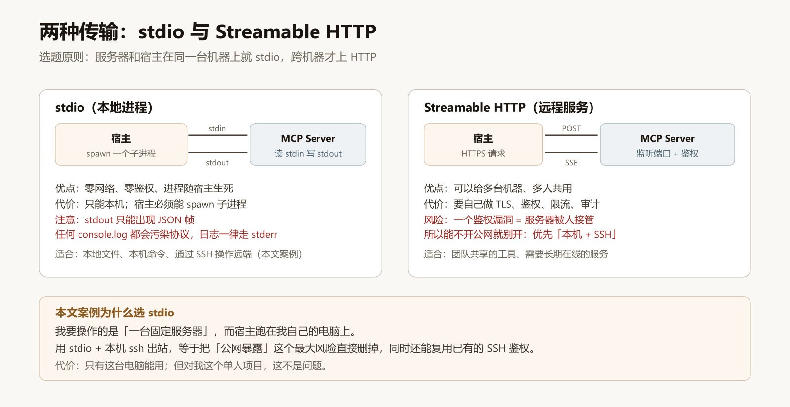
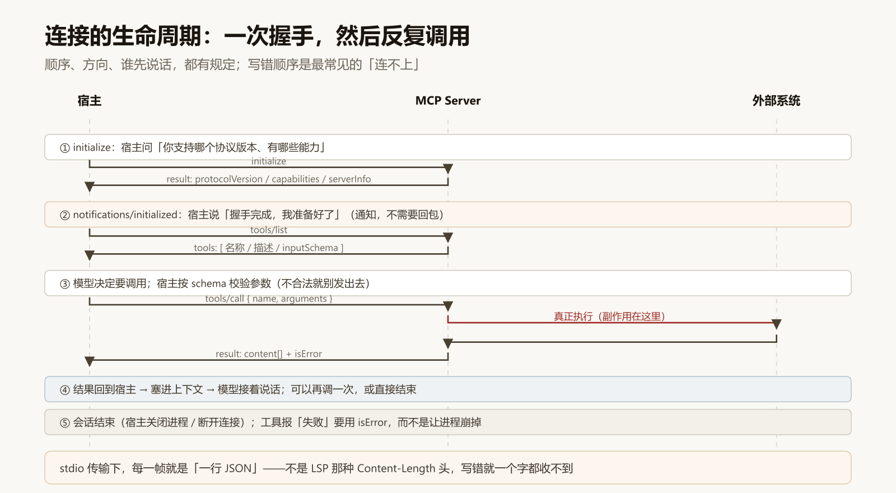
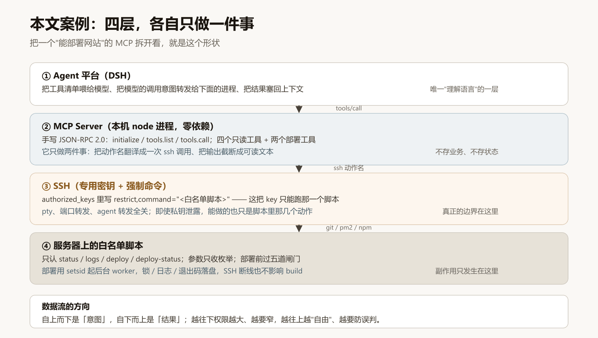
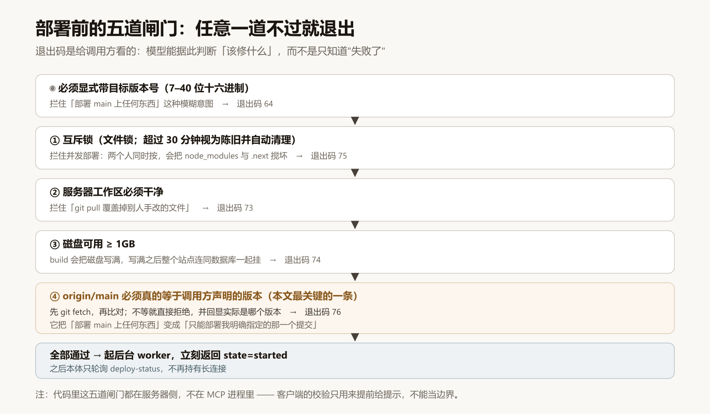
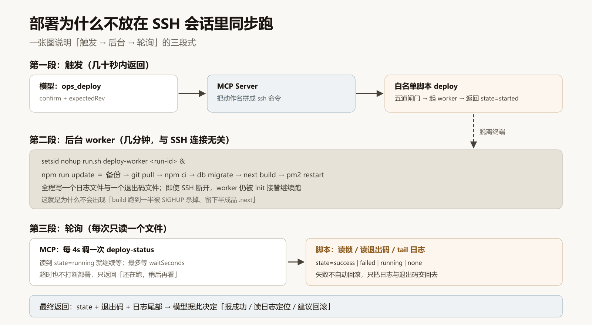
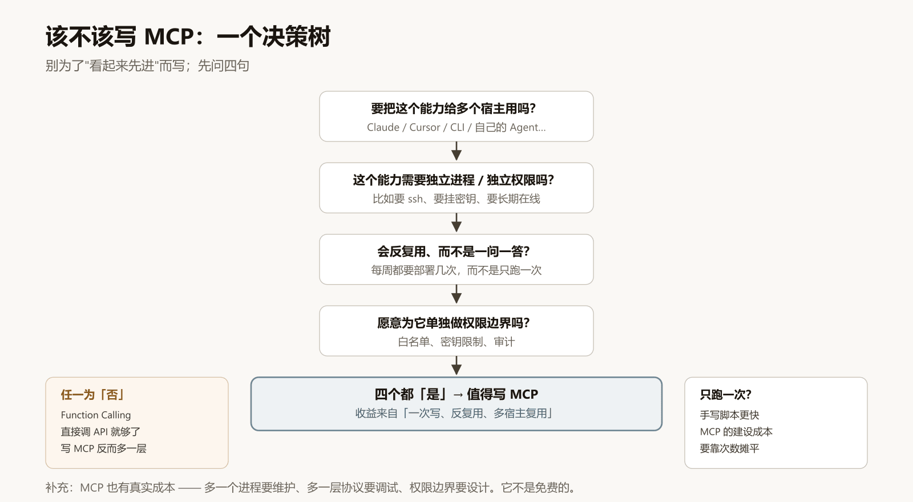

# 从 0 到 1 做一个 MCP：把我服务器的部署权限，安全地交给 AI

> 这篇文章基于一个真实项目：我给自己的博客做了一个运维 MCP，让 AI 能自己看服务器状态、也能在我明确点头后完成部署。全文从概念讲到能跑的代码，所有数字与退出码都是那次真实运行的结果，**不是示例值**。

---

## 0. 为什么要自己做 MCP

我的博客跑在一台云服务器上。以前每次改完代码，流程是：本地提交 → 推 GitHub → 打开 Workbench 网页终端 → 敲 `npm run update` → 盯着日志等三四分钟 → 浏览器刷新看看有没有白屏。

这个流程一年要跑几十次。它不是难，是**碎**：要换窗口、要记命令、要人肉看日志。

于是我做了个东西，让 AI 直接接上服务器：

```
我：部署最新
AI： （查状态 → 确认版本 → 触发部署 → 轮询日志）
     部署成功，3m41s，退出码 0，站点 200，PM2 重启计数 85
```

它背后就是 **MCP（Model Context Protocol）**。这篇文章讲清楚三件事：**它是什么**、**它和 Function Calling 到底谁是谁**、**怎么写一个能上生产的最小实现**。

---

## 1. MCP 是什么：标准化的是「插座」，不是「电器」

一句话：**MCP 是宿主（Host）与工具进程（Server）之间的接口标准**，用 JSON-RPC 2.0 说话，定义了「怎么发现能力、怎么调用、结果怎么回来」。

它解决的问题非常具体。假设你有 3 个 Agent 平台（Claude Desktop、Cursor、自己的 CLI Agent），和 3 个想接的能力（GitHub、数据库、部署脚本）：

- **没有标准**：每个平台 × 每个能力 = 9 份胶水代码，各自处理鉴权、超时、错误格式
- **有了标准**：能力只写一次（3 份），每个平台只写一行配置（3 行）



注意这张图里没有出现的两件事，恰恰是很多人误解的地方：

1. **MCP 不让模型变聪明**。它只解决「工具接得进」。
2. **MCP 不规定模型怎么想**。模型要不要调用、调哪个、参数填什么，仍然由模型自己决定。

所以它的定位是**基础设施**，不是「AI 能力」。你把它理解成「AI 世界的 USB-C 接口标准」也可以，但我更愿意说：它统一的是**进程间的那根管子**。

---

## 2. 四个角色：谁在想、谁在干、谁被干

这是整篇文章最重要的一张图。把四个角色分清，后面所有概念都能挂上去。



| 角色 | 会做什么 | 绝不会做什么 |
| --- | --- | --- |
| **LLM（模型）** | 输出文本、判断意图、说出结构化的调用请求 | 读文件、联网、执行命令 |
| **Agent 平台（Host）** | 跟模型对话、替模型执行、管理 MCP 连接生命周期 | 不懂你的业务 |
| **MCP Server** | 把能力翻译成协议；参数校验；调用外部系统 | 不知道模型存在，拿不到对话历史 |
| **外部系统** | 真正被改的东西（数据库、服务器、SaaS） | —— 副作用与风险都在这一层 |

三个常见混淆，一次说清：

- **MCP Client 在哪？** 在宿主里。它是宿主的一个模块，负责跟某个 MCP Server 保持一条连接。你不需要单独部署一个 Client。
- **MCP Server 能感知模型吗？** 不能。它只知道「有人通过协议调了我的 `status` 工具」，不知道对方是 GPT 还是 Claude，也不知道用户说了什么。
- **谁负责鉴权？** 传输层。stdio 传输基本靠「同一台机器上的进程权限」，HTTP 传输才需要 token/OAuth。这一点后面会展开。

---

## 3. MCP 与 Function Calling：谁代表哪一部分

这是我被问得最多的问题。答案是：**它们不在同一个层面上，不是替代关系**。



拆开看：

- **Function Calling（工具调用）** 是**模型说话的格式**。模型不执行任何东西，它只是说出一段结构化的意图：

```json
{ "name": "deploy", "arguments": { "expectedRev": "bd2a365" } }
```

  模型能做到这一步，是因为宿主把「有哪些工具、参数长什么样」放进了上下文。它的产物是**一句话**，不是一个动作。

- **MCP** 是**宿主与工具进程之间的接口标准**。宿主拿到那句「话」之后，可以本地执行（那就是纯 Function Calling），也可以沿着 MCP 转发给一个独立进程（那就是 MCP）。

所以准确的表述是：

| 问题 | 答案 |
| --- | --- |
| 「模型知道要调用工具」靠什么？ | Function Calling（schema 在上下文里） |
| 「调用真的到达工具」靠什么？ | 宿主的执行逻辑；如果要跨进程，靠 MCP |
| 两者能一起用吗？ | 必须一起用，而且这才是常态 |

一句话记忆：**Function Calling 管「说」，MCP 管「送」**。

---

## 4. MCP 的内部结构（写代码前必须知道的四件事）

### 4.1 两种传输



| | stdio | Streamable HTTP |
| --- | --- | --- |
| 形态 | 宿主 spawn 一个子进程，读 stdin 写 stdout | 宿主发 HTTPS 请求，服务端用 SSE 回 |
| 鉴权 | 进程权限（本机） | 必须自己做 token / OAuth / IP 限制 |
| 风险 | 低（不暴露网络） | **高**：一个鉴权漏洞 = 服务被接管 |
| 适合 | 本机工具、通过 SSH 操作远端 | 团队共享、长期在线 |

我的案例选 stdio。原因很实际：我要操作的是「一台固定服务器」，而宿主跑在我自己的电脑上。用 **stdio + 本机 ssh 出站**，等于把「公网暴露」这个最大风险直接删掉，同时还能复用已有的 SSH 鉴权。

### 4.2 生命周期



顺序是固定的，而且**顺序写错是最常见的「连不上」**：

1. `initialize` —— 宿主问：你支持哪个协议版本、有哪些能力
2. `notifications/initialized` —— 宿主说：握手完成（通知，**不需要回包**）
3. `tools/list` —— 宿主拉工具清单
4. `tools/call` —— 调用（可以反复发生）
5. 会话结束

### 4.3 工具清单就是「给模型的说明书」

`tools/list` 返回的是一个数组，每一项包含 `name` / `description` / `inputSchema`。**模型能正确调用，几乎全靠这段话写得好不好**：

```json
{
  "name": "deploy",
  "description": "在服务器上部署。会重启线上服务。必须 confirm: true，并给出目标提交号 expect；服务器侧会校验该提交是否真的存在。",
  "inputSchema": {
    "type": "object",
    "properties": {
      "confirm": { "type": "boolean", "description": "必须为 true" },
      "expect": { "type": "string", "description": "目标提交号（7–40 位十六进制）" }
    },
    "required": ["confirm", "expect"],
    "additionalProperties": false
  }
}
```

三个实践要点：

- `description` 里直接写「会重启线上服务」——模型会据此决定要不要先问你一句
- `required` 与 `enum` 能用就用，别指望提示词约束参数
- `additionalProperties: false` 能少一堆脏参数

### 4.4 失败要用 `isError`，不要让进程崩掉

工具执行失败有两种报法，效果完全不同：

- **返回 `isError: true` 的文本** → 模型能看到「为什么失败」，可以自我修正
- **抛异常 / 让进程退出** → 宿主只看到一条 internal error，模型拿不到可读原因，甚至整条连接断掉

```js
if (!r.ok) return { text: `读取状态失败：\n\n${r.output}`, isError: true }
```

---

## 5. 手把手：以我的运维 MCP 为例

下面这部分就是完整实现思路。代码都已脱敏，能直接改成你自己的。



### 5.1 先定边界，再写代码

写 MCP 之前先回答一个问题：**AI 最坏能做什么？**

我的答案写死了三条：

1. **只读工具随便用**（看版本、看日志、比对版本、探测站点）
2. **写操作必须我在对话里明确说**，而且要带目标版本号
3. **服务器侧再卡一道**：那把 SSH 密钥被限制成「只能跑一个白名单脚本」

第 3 条是整个设计的支点。它意味着：**即使 MCP 进程被完全攻破、即使私钥泄露，能做的也只是脚本里那几个动作。**

### 5.2 服务器侧：一个只认枚举动作的脚本

> 完整代码见 `snippets/run.sh`。

核心是把「命令」换成「白名单 + 枚举参数」：

```bash
ACTION="${SSH_ORIGINAL_COMMAND:-status}"
CMD="${ACTION%% *}"        # 第一个词当动作名
ARG=""
[ "$CMD" != "$ACTION" ] && ARG="${ACTION#* }"

case "$CMD" in
  status)  ... ;;          # 只读
  logs)    case "$ARG" in 20|50|100) N="$ARG" ;; *) exit 64 ;; esac ;;
  deploy)  ... ;;          # 见下
  *)       echo "denied" >&2; exit 64 ;;
esac
```

配合 `authorized_keys` 的强制命令，这把密钥就变成了「只能按这几个按钮」：

```
restrict,command="/opt/demo-ops/run.sh" ssh-ed25519 AAAA... demo-ops
```

`restrict` 会关掉 pty、端口转发、agent 转发、X11。效果实测：`rm -rf`、`cat /etc/shadow`、`logs 9999` 三种越界请求全部返回 `denied` + **退出码 64**。

### 5.3 部署的五道闸门



这五道全部在**服务器侧**（不在 MCP 进程里），所以绕不过：

| 闸门 | 拦住什么 | 退出码 |
| --- | --- | --- |
| 必须带目标版本号（7–40 位十六进制） | 「部署 main 上任何东西」 | 64 |
| 互斥锁（>30 分钟自动视为陈旧） | 并发部署把 `node_modules` / `.next` 搅坏 | 75 |
| 工作区必须干净 | `git pull` 覆盖别人的手改 | 73 |
| 磁盘 ≥ 1GB | build 写满磁盘，连数据库一起挂 | 74 |
| `origin/main` 必须等于声明的版本 | 部署到你没预期的那一版 | 76 |

第 5 条是我最满意的一条。它把「帮我部署」这种模糊意图，变成「只能部署 `bd2a365` 这一版」这种确定动作：

```bash
git -C "$APP_DIR" fetch --quiet origin main
REMOTE_REV="$(git -C "$APP_DIR" rev-parse origin/main)"
case "$REMOTE_REV" in
  "$ARG"*) ;;
  *) echo "denied: 目标版本不匹配（origin/main=${REMOTE_REV:0:7}）" >&2; exit 76 ;;
esac
```

### 5.4 部署不能放在 SSH 会话里同步跑



这是我踩过的一个真坑。`npm run update` 要跑 3–4 分钟。如果同步执行，**SSH 一断，远端进程会被 SIGHUP 杀掉**，可能停在「`.next` 是半成品、PM2 还没重启」的状态 —— 那是最糟糕的中间态。

正确做法是「三段式」：

```bash
# ① 触发：立刻返回
RUN_ID="$(date +%Y%m%d%H%M%S)"
echo "$RUN_ID" >"$LOCK"
setsid nohup "$SELF" deploy-worker "$RUN_ID" >/dev/null 2>&1 </dev/null &
echo "state=started"; echo "run=$RUN_ID"

# ② 后台 worker：写日志与退出码，与 SSH 连接无关
{ echo "=== start $(date -Is) ==="; npm run update; CODE=$?; echo "$CODE" >"$EXITFILE"; } >>"$LOGFILE" 2>&1
rm -f "$LOCK"

# ③ 宿主侧轮询：每次只读一个文件
MCP: 每 4s 调一次 deploy-status → state=running/success/failed
```

### 5.5 MCP 侧：零依赖手写协议

> 完整可运行版本见 `snippets/mcp-server.mjs`，`node mcp-server.mjs --selftest` 可直接跑。

整个服务器只用 Node 内置模块。协议层比想象中短：

```js
const send = (msg) => process.stdout.write(JSON.stringify(msg) + "\n")
const reply = (id, result) => send({ jsonrpc: "2.0", id, result })

async function handle({ id, method, params }) {
  switch (method) {
    case "initialize": {
      const asked = params?.protocolVersion
      reply(id, {
        protocolVersion: SUPPORTED.includes(asked) ? asked : SUPPORTED[0],
        capabilities: { tools: { listChanged: false } },
        serverInfo: { name: "demo-ops", version: "1.0.0" },
      })
      return
    }
    case "notifications/initialized": return   // 通知不回包
    case "tools/list": reply(id, { tools: TOOLS }); return
    case "tools/call": {
      const handler = HANDLERS[params.name]
      if (!handler) return replyError(id, -32602, `未知工具：${params.name}`)
      const r = await handler(params.arguments || {})
      reply(id, { content: [{ type: "text", text: r.text }], isError: Boolean(r.isError) })
      return
    }
  }
}
```

⚠️ **stdio 传输是「一行一个 JSON」**，不是 LSP 那种 `Content-Length` 头。写错的话你一个字节都收不到 —— 而且不会有任何报错，只会安静地超时。

另外一条硬规则：**stdout 只能出现 JSON 帧**。任何 `console.log` 都会污染协议，日志一律走 `stderr` 或文件。我的做法是全程用 `audit()` 写文件，一个 `console.log` 都没有。

### 5.6 接进宿主：一行配置

> 见 `snippets/registration.yml`（同时给了 Claude Desktop 与另一种插件式宿主的写法）。

同一个 MCP Server，换宿主只改配置：

```json
{
  "mcpServers": {
    "demo-ops": {
      "command": "node",
      "args": ["/absolute/path/to/mcp-server.mjs"],
      "env": { "DEMO_HOST": "<服务器地址>", "DEMO_USER": "<用户>", "DEMO_KEY": "<专用密钥>" }
    }
  }
}
```

我自己用的宿主是插件式配置（YAML），关键是 `serverName` 决定工具前缀 —— 工具会以 `mcp__demo-ops__status` 这样的名字出现在模型面前。

### 5.7 跑通：三步，从只读到部署

**第一步，只读。** 先上线只读工具，确认「能看见」：

```
ops_status  → 版本 bd2a365 / 分支 main / 工作区干净
               PM2 next-app online（重启 85 次） / 磁盘 40G 用 47%
```

**第二步，拒绝测试。** 这一步比「能用」更重要 —— 要证明**越界会被拦住**：

| 尝试 | 结果 |
| --- | --- |
| `ssh <key> "rm -rf /tmp/x"` | denied，退出码 64 |
| `ssh <key> "cat /etc/shadow"` | denied，退出码 64 |
| `ssh <key> "logs 9999"` | denied，退出码 64 |
| `deploy`（不带版本） | denied，退出码 64 |
| `deploy HEAD`（非法版本号） | denied，退出码 64 |
| `deploy deadbeef…`（版本不匹配） | denied，**退出码 76** |

**第三步，真部署。** 两次真实运行：

| 目标 | 耗时 | 退出码 | PM2 重启计数 |
| --- | --- | --- | --- |
| `19ff5e5` | 3m49s | 0 | 84 |
| `bd2a365` | 3m41s | 0 | 85 |

部署后自动核对：站点首页 200 / 500ms，`/blog` 200 / 997ms。

---

## 6. 七个真坑（按踩到的顺序）

| # | 现象 | 根因 | 怎么改 |
| --- | --- | --- | --- |
| 1 | 工具调用后宿主立刻断开 | stdio 用了 `Content-Length` 帧格式 | 改成**一行一个 JSON** |
| 2 | 什么都收不到，也不报错 | 代码里有 `console.log`，污染了 stdout | 日志写 stderr / 文件 |
| 3 | 模型说「工具报错了」，但看不到原因 | 用 `throw` 而不是 `isError: true` | 失败要返回可读文本 + `isError` |
| 4 | 部署跑一半失败，服务起不来 | SSH 断线 → SIGHUP 杀掉 build | `setsid nohup` + 锁 + 日志/退出码落盘 |
| 5 | 想 `scp` 传新脚本，连不上 | `restrict` + 强制命令把 `scp` 也拦了 | 这是**特性**：换通道（粘贴 / 另开一段授权的密钥） |
| 6 | 助手拿不到工具，只看到旧列表 | 工具清单在**启动时**拉取 | 改完 server 代码要重启宿主/插件 |
| 7 | 上下文被日志灌爆 | 一次 `pm2 logs` 返回几千行 | 服务端限行数（20/50/100）+ 客户端截断（我设 12KB） |

第 5 条值得多说一句：你不能既要求「密钥只能跑一个脚本」，又期待它能 `scp`。**安全特性的代价就是灵活性**，这一点要提前想清楚。

---

## 7. 该不该写 MCP：一个决策树



四句话自测，**任一为「否」就不必写**：

1. 这个能力要给**多个宿主**用吗？
2. 它需要**独立进程 / 独立权限**吗（比如要挂密钥、要长期在线）？
3. 你会**反复**用它，而不是只跑一次？
4. 你愿意为它**单独设计权限边界**吗？

如果四句都是「是」，MCP 的收益（一次写、反复用、多宿主复用）才压得过成本（多一个进程、多一层协议、多一套权限设计）。

反过来，如果只是「让模型能查个天气」这种一次性、无权限、单宿主的需求，**Function Calling 直接调 API 就够了**，套 MCP 只是多一层要维护的东西。

---

## 8. 可直接抄的安全清单

1. **不给任意命令**。只暴露枚举动作，参数只收枚举值。
2. **边界放在最下游**。校验写在服务器脚本里，客户端的校验只是「提前提示」。
3. **专用凭据**。为这个用途单独生成密钥，与日常登录分开。
4. **限制凭据能力**。`restrict` + 强制命令，让泄露的后果有上限。
5. **优先不开公网**。能本机 stdio 就不要 HTTP 暴露。
6. **写操作要显式确认**。`confirm: true` + 目标版本号，拒绝「顺手调用」。
7. **目标可验证**。让服务端校验「你要的版本 == 远端真实版本」。
8. **互斥与冷却**。锁文件 + 超时清理，防止并发把环境搅坏。
9. **审计到文件**。每次调用落一行（时间/动作/参数/来源 IP），本地与服务器各一份。
10. **失败不自动回滚**。把日志与退出码交回给人，回滚由人决定 —— 自动回滚会冲掉现场。

---

## 9. 总结

- MCP 标准化的是**管子**（宿主 ↔ 工具进程），不是模型能力，也不是你的业务。
- **Function Calling 管「说」，MCP 管「送」**；两者叠起来用才是常态。
- 一个能上生产的最小实现，难点不在协议（几十行就够），而在**边界**：白名单、凭据限制、闸门、审计。
- 写之前先问「AI 最坏能做什么」，答案决定了整个设计。

我的那份实现至今只在做三件事：看状态、看日志、在我点头后部署。它没有「任意命令」这个能力 —— 而正是这个「没有」，让它敢被用在生产上。

---

### 附录

- 可运行代码：`snippets/mcp-server.mjs`（自检：`node mcp-server.mjs --selftest`）
- 服务器侧白名单脚本：`snippets/run.sh`（建议先 `bash -n` 过一遍语法再上服务器）
- 宿主注册写法：`snippets/registration.yml`
- 示意图源文件：`diagrams/*.svg`（手写 SVG，改字重画即可）

> 文中所有主机名、用户名、密钥文件名、目录路径均已脱敏为占位符；所有退出码与耗时来自真实运行记录。
