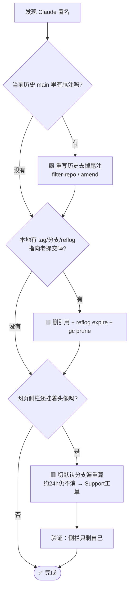

# 🧹 如何把 GitHub 仓库里的「Claude 署名」彻底删掉 —— 一次实战全记录

> 📌 起因：个人博客仓库 [LanKnight/lankhub](https://github.com/LanKnight/lankhub) 的首页右侧 **Contributors** 里冒出一个 `@claude`，仓库里还有一批提交带着 `Co-Authored-By: Claude <noreply@anthropic.com>`。代码是自己一行行写的，署名却是 AI 的 —— 这事看着小，删起来坑连着坑。本文把**排查思路、删除手段、踩过的坑、验证清单**完整记下来，下次（不分 Claude，任何幽灵协作者）照着走即可。

---

## 🗺️ 一、先认清：所谓「署名」其实分三层

很多人一上来就 `git push --force`，结果发现网页上那个头像纹丝不动 —— 因为**你删的根本不是同一层的东西**。动手前先分清这三层，每层的删除手段和"生效速度"完全不同：

| 层级 | 它到底是什么 | 在哪能看到 | 删除手段 | 生效延迟 |
| --- | --- | --- | --- | --- |
| 🟩 **① 当前历史** | 现存分支可达提交的信息里真有 `Co-Authored-By` 尾注 | `git log`、GitHub commit 页 `.patch` | 重写历史（filter-repo / amend） | 即时 |
| 🟨 **② 本地旧对象** | 分支/tag/reflog/stash 还指向带署名的老提交 | `git fsck --unreachable`、`git for-each-ref` | 删引用 + reflog expire + gc prune | 即时（仅本地） |
| 🟥 **③ GitHub 服务端缓存** | 历史已经干净了，但贡献者索引/CDN 还是旧的 | 仓库首页右侧 Contributors | **切默认分支逼重算** / 提 Support 工单 | ⚠️ 官方称约 **24h** |

> 💡 本次的真相就是：第 ① 层早已干净，第 ② 层是本地一枚备份 tag，第 ③ 层才是"怎么推都赶不走"的那行 `claude`。逐层定位，才不会白忙一场。

---

## 🔍 二、排查：怎么判断卡在哪一层

### 2.1 看当前历史里到底还有没有署名 🟩

```bash
# 提交信息里搜（-i 忽略大小写）
git log --all -i --grep="Co-Authored-By: Claude" --format="%h %s"

# 只看当前分支（去掉 --all），这是"现存历史"的真实情况
git log -i --grep="Co-Authored-By" --format="%h %s" main
```

- 若 **`--all` 命中、`main` 不命中** → 说明是别的引用（tag/分支）挂着老历史，问题在 🟨。
- 若 **`main` 也命中** → 当前历史本身脏，问题在 🟩，要重写。

> ⚠️ Windows PowerShell 里 `git log` 的进度/警告会走 **stderr 被标红**，看着像报错其实正常；真判断成败看**退出码**（`$LASTEXITCODE`）和实际输出行。

### 2.2 看远端和本地分别还有哪些引用 🟨

```bash
# 远端全部引用 —— 重点看有没有你本地没拉过的"古董分支/Tag"
git -c http.proxy=http://127.0.0.1:7897 -c https.proxy=http://127.0.0.1:7897 ls-remote origin

# 本地全部引用（分支/tag）与指向的对象
git for-each-ref --format="%(objecttype) %(refname) %(objectname:short)"

# 本地不可达对象（gc 前会被列出来，gc --prune=now 后才清零）
git fsck --unreachable --no-progress | Measure-Object -Line
```

> 🕳️ **大坑**：一定要 `git ls-remote` 看远端、`for-each-ref` 看本地。本次本地就藏着一枚 `backup-before-rewrite` 的 tag，指着 27 个带署名的老提交。只要它还"可达"，一次手滑的 `push --mirror` 就能让署名原地复活。

### 2.3 用浏览器/接口看服务端缓存 🟥

历史干净了、侧栏还挂着头像，就是第 ③ 层。用两处交叉验证：

- **贡献者数据接口**（权威）：`.../graphs/contributors-data?all=1` 返回的数组才是"底层真相"。本次它只有 `[{login:"LanKnight"}]`。
- **首页右侧 Contributors 区块**（渲染）：却显示 2 人，含 `@claude`。

两者不一致 = **典型的缓存滞后**，不是历史问题。

---

## 🧨 三、为什么 `@claude` 会被算成贡献者？

关键机制一句话：**GitHub 判定一次提交归属，看的是提交里的 Author/Co-author 邮箱，然后拿这个邮箱去全网匹配已注册的 GitHub 账号。**

```
Co-Authored-By: Claude <noreply@anthropic.com>
                          └── 这个邮箱恰好关联到真实账号 @claude（ID 81847）
                                 ⇒ 头像就永久挂上了仓库首页
```

> 🔑 所以哪怕你重写历史删掉了尾注，只要服务端**贡献者索引**没重算，头像就不走。单纯 `push --force` 触发不了全站重算 —— 这正是"删了还在"的根因。

---

## 🛠️ 四、删除手段总览（按风险从低到高）



### 🟩 层①：重写当前历史（真带尾注时才用）

优先用 [`git filter-repo`](https://github.com/newren/git-filter-repo)（比 `filter-branch` 快且安全）：

```bash
# 用回调把所有提交信息里的 Co-Authored-By: Claude 行删掉
git filter-repo --message-callback '
  return re.sub(rb"^Co-Authored-By: Claude <noreply@anthropic\.com>\n\n?", b"", message, flags=re.M)
'
```

`filter-branch` 也能做，但它会留下 `refs/original/` 备份引用，务必一并删除（见层②）。

### 🟨 层②：清掉本地旧对象（本次实操，零风险）

```bash
git tag -d backup-before-rewrite              # 删备份 tag
git branch -D backup-before-rewrite 2>$null   # 若同名分支存在也删（本次其实只有 tag）
git reflog expire --expire=now --all          # 清 reflog，断掉最后的可达路径
git gc --prune=now                            # 物理丢弃不可达对象
git fsck --unreachable --no-progress | Measure-Object -Line   # 复查应为 0
```

> 🗑️ 删完一定要 `git cat-file -t <老SHA>` 验证 —— 返回 `Not a valid object name` 才算真没了。此后无论普通 push 还是 `--mirror` 都不可能把它推回去。
> ⚠️ 注意 `git gc --dry-run` 在本机 git `2.50.1` 不支持，会直接报错。

### 🟥 层③：逼 GitHub 重算贡献者缓存（本次的关键一击）

历史和本地都干净了，侧栏还赖着 —— 用**默认分支来回切**触发重算，这是**不改任何内容**里最有效的一招：

1. 推一个临时分支（可在 Settings 里被选为默认）：
   ```bash
   git checkout -b temp-cache-refresh
   git commit --allow-empty -m "chore: 临时分支用于触发贡献者缓存重算"
   git -c http.proxy=http://127.0.0.1:7897 push origin temp-cache-refresh
   ```
2. 网页 **Settings → Branches → Default branch**：`main → temp-cache-refresh`，确认；等 **20~30 秒**；再切回 `main`。
3. 硬刷新（Ctrl+F5）首页，看 Contributors。
4. 收尾删临时分支：
   ```bash
   git -c http.proxy=http://127.0.0.1:7897 push origin --delete temp-cache-refresh
   git branch -D temp-cache-refresh
   ```

> ✅ 本次效果立竿见影：切完再刷新，侧栏从「2 人（含 claude）」变成「**1 人（只剩 LanKnight）**」。
> 🧠 原理：贡献者索引以**默认分支可达历史**为准；默认分支指向一段"只属于你"的新历史会强制它重算，切回 main 后再算一次 —— 而干净的 main 历史里没有 `@claude`，于是头像掉了。

### ☢️ 兜底方案（前面都不奏效再考虑）

| 方案 | 代价 | 说明 |
| --- | --- | --- |
| 🔁 orphan 空历史强推覆盖 main | ⚠️ 高：默认分支短暂"几乎空"，需 `--force` | 社区"休克疗法"，比切分支暴力 |
| 🎫 提 GitHub Support 工单 | 🕐 慢：等回复，需登录 | 请其清除 force-push 后残留的旧对象缓存 |
| 🗑️ 删库重建 | 💸 最高：丢 star/issue/旧 URL | 100% 干净，但非必要不建议 |

---

## ⚠️ 五、踩坑清单（血泪浓缩）

1. 🚫 **「删了还在」几乎都是缓存层，不是历史层。** 先分清 ①②③，别对着已经干净的 `main` 反复 force-push。
2. 🕳️ **本地备份 tag/分支是复活的种子。** `for-each-ref` + `ls-remote` 双查，任何指向老历史的引用都要删干净，再 `reflog expire` + `gc --prune=now`。
3. 🧾 **`filter-branch` 会留 `refs/original/`。** 不清掉等于白重写。
4. 📛 **老 SHA 直链会残留一阵。** `.../commit/<老SHA>` 短期还能打开、还带着尾注，那是服务端旧对象缓存，**不影响首页侧栏和统计**，会自行过期；急也没用，只能等或走 Support。
5. 🏷️ **「标题里出现 Claude」≠「署名」。** commit 搜索仍能搜到那条写着"清理 Claude Code 残留"的**标题**，但它不是 co-author 尾注，不会被算成贡献者。区分"署名"与"文字"，别误伤。
6. 🔌 **国内网络 push 被重置（`Connection was reset`）就走代理。** 本项目端口 `127.0.0.1:7897`：`git -c http.proxy=... -c https.proxy=... push ...`。
7. 🖥️ **PowerShell 里 git 的 stderr 会标红。** 看着像报错，实际看退出码/输出判断成败。
8. 🔐 **默认分支切换需要登录态。** 自动化操作别替你填凭据；先人工登录，再走 Settings。
9. ✉️ **根因在邮箱映射。** 只要历史上出现过 `noreply@anthropic.com` 这类被 GitHub 关联到真实账号的邮箱，头像就会挂上 —— 从源头规范 `git config user.email` 才能治本（见下节）。

---

## 🛡️ 六、防止再次发生

- ⚙️ **规范提交身份**：`git config --global user.name` / `user.email` 设成你自己的、且已在你 GitHub 账号里验证的邮箱。
- 🚫 **关掉 AI 工具的 co-author 尾注**：多数会写 `Co-Authored-By: Claude` 的工具可通过配置/环境变量关闭该行为，从源头不产生尾注。
- 🪝 **提交钩子兜底**：`commit-msg` 钩子里正则剥离不想要的尾注。
- 🤖 **CI 自检**：加一步 `git log --grep="Co-Authored-By: Claude" ` 命中即失败，防止混进主干。

---

## ✅ 七、完成态验证清单

- [x] `git log main -i --grep="Co-Authored-By: Claude"` → 无输出（当前历史干净）
- [x] `git ls-remote origin` → 只有 `refs/heads/main`，无古董分支/tag
- [x] `git fsck --unreachable` → 0 个不可达对象（本地旧对象已物理清除）
- [x] GitHub commit 搜索全库搜 "claude" → 仅 1 条**标题**（非署名）
- [x] `contributors-data?all=1` → 只有 `LanKnight`
- [x] 首页右侧 Contributors 硬刷新后 → **仅 1 人（LanKnight）** 🎉

---

## 📎 附：本次涉及的仓库/对象事实（备查）

| 项 | 值 |
| --- | --- |
| 仓库 | `github.com/LanKnight/lankhub` |
| main tip | `781eabd`（当前历史，已无署名尾注） |
| 本地备份 tag | `backup-before-rewrite` → `71d1d5b`（含 27 个带 `Co-Authored-By: Claude` 老提交，已删） |
| 幽灵贡献者 | 登录名 `claude`（显示名 Claude，GitHub ID 81847），经邮箱 `noreply@anthropic.com` 关联 |
| 破缓存手段 | 默认分支 `main → temp-cache-refresh(5895930) → main` 来回切，切完即只剩 1 人 |
| 网络代理 | `127.0.0.1:7897`（git 网络命令） |
| 工具版本 | git `2.50.1`（注意：不支持 `gc --dry-run`） |

> 🧭 一句话收尾：**先分层定位，再对症下药。** 历史层用重写、本地层用 gc、缓存层用"切默认分支"。对着缓存反复 force-push，是这件事最容易浪费时间的地方。
